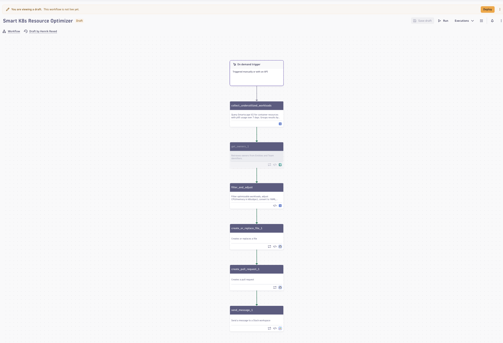

<!-- STEP_SETUP
commands:
  - generateWorkflow
-->

# 4. Run the Smart K8s Resource Optimizer Workflow

Dynatrace **Workflows** run DQL and code on a schedule or on demand. The *Smart K8s Resource
Optimizer* turns the analysis of the last step into numbers: per container, the CPU and memory
request to set.



| Task | What it does |
|---|---|
| `collect_underutilized_workloads` | DQL on **Smartscape**: container → pod → workload, keeps workloads annotated `resource-optimization.dynatrace.com/enabled: "true"`, joins 7-day p95 usage and requests |
| `compute_recommendations` | JavaScript: new CPU (millicores) and memory (MiB) request per container, p95 usage × 1.30 |

!!! note "Changed from the original workshop"
    Upstream, two more tasks patched the manifests in each attendee's GitHub fork and opened a pull
    request, and merging it rolled the change out. Here no fork and no GitHub token are needed: the
    workflow shows the recommendations in Dynatrace, and in the next step you apply the same
    recommendations to your cluster from the terminal.

## Deploy  the workflow


<!-- STEP_SETUP
commands:
  - echo "deploying the resource optimizer worfflow"
  - dtctl apply -f .devcontainer/yaml/gen/smart-resource-optimizer.workflow.yaml
-->

Then, in your tenant:

1. Download the file: in the Explorer, right-click `.devcontainer/yaml/gen/smart-resource-optimizer.workflow.yaml` → **Download**.
2. Open the **Workflows** app and choose **Upload**, then select the file.
3. The workflow opens as *Smart K8s Resource Optimizer ({{DT_SESSION_ID}})*. Choose **Run**.

!!! warning "First run fails with `Missing OAuth scope 'storage:smartscape:read'`?"
    A workflow runs with **your** permissions, but only those you have authorized the
    AutomationEngine to use. Open the Workflows app's settings (gear icon) → **Authorization
    settings**, search for `storage:smartscape:read`, tick it, **Save**, and run again. If the page
    says the change won't take effect, your user lacks the permission itself: tell your trainer.

## Read the result

When the run is green, select the `compute_recommendations` task and open its **Result**:
`recommendations` lists, per workload and container, the current and the new CPU and memory request.
The task's **Log** prints one line per container, for example:

```text
cart/cart: cpu 0m -> 29m, memory 100Mi -> 243Mi
```

The same query runs from your terminal — this is what you apply in the next step:

```bash
showRecommendations
```

This check proves the recommendations for your cluster can be computed — the same numbers the
workflow shows:

<!-- LAB_QUESTION
type: shell-verification
question: "Verify recommendations exist for your otel-demo workloads"
buttonText: "Check recommendations"
command: "showRecommendations"
expect:
  operator: exit-zero
hint: "Dynatrace needs a few minutes of usage data for a fresh cluster. Wait and check again. If it reports a missing token, tell your trainer."
explanation: "Dynatrace computed new requests for your workloads from their measured usage."
-->

<!-- LAB_QUESTION
type: multiple-choice
question: "Your workflow run returns no recommendation for a workload. What is the most likely reason?"
options:
  - "Its pods do not carry the annotation resource-optimization.dynatrace.com/enabled: \"true\""
  - "The workflow only looks at StatefulSets"
  - "The OpenTelemetry Collector does not export spans for it"
  - "The k6 load generator is not running"
correct: 0
explanation: "The optimizer only considers opted-in workloads: the annotation is read from Smartscape, so workloads without it are never changed."
-->

<!-- LAB_NO_SOLUTION: the upload and run happen in the Workflows app; learner tokens cannot hold automation scopes, so no command can repeat them — and nothing later depends on them: step 5 computes the same recommendations from the terminal -->


