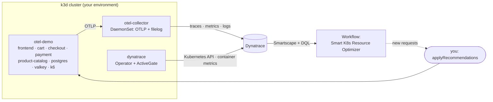

# K8s Autoscaling Workshop

{ width="160" }

Optimize a Kubernetes cluster with Dynatrace **Smartscape**, **DQL** and a **Workflow**: find the
workloads whose resource requests do not match what they really use, compute better requests from
the observed p95 usage, apply them and watch the gap between *requested* and *used* shrink.

## What you will be able to do

By the end of this workshop you can find mis-sized Kubernetes workloads in Dynatrace and right-size
their CPU and memory requests from real usage data.

## Who it is for

Platform engineers and SREs who run workloads on Kubernetes and know `kubectl`. No Dynatrace
experience is needed; DQL is shown, not assumed.

## What is already running

When you press **Start**, your environment is built for you:

| Component | Where | Purpose |
|---|---|---|
| k3d cluster | your environment | a single-node Kubernetes cluster |
| Dynatrace Operator + DynaKube | namespace `dynatrace` | ActiveGate with Kubernetes monitoring: feeds Smartscape and the container CPU and memory metrics |
| OpenTelemetry Collector (DaemonSet) | namespace `otel-collector` | receives OTLP from the demo, reads pod logs (`filelog`), enriches with Kubernetes metadata, converts metrics to delta and exports everything to Dynatrace |
| `opentelemetry-demo-light` | namespace `otel-demo` | frontend, cart, checkout, payment, product-catalog, postgres, valkey and a k6 load generator |

## The loop you will run

1. Check the environment and see your telemetry arrive in Dynatrace.
2. Find the mis-sized workloads with DQL on Smartscape.
3. Run the **Smart K8s Resource Optimizer** workflow in the Workflows app.
4. Apply its recommendations to your cluster.
5. Watch the gap between requested and used resources shrink.

## Credits

This workshop is **Henrik Rexed's** [K8s-autoscalingWorkshop](https://github.com/henrikrexed/K8s-autoscalingWorkshop),
using his [opentelemetry-demo-light](https://github.com/henrikrexed/opentelemetry-demo-light), migrated
to the Dynatrace enablement framework so it runs in the Enablement app. What changed is listed in the
repository README.

<!-- The welcome page carries no check: it only introduces the training. -->

<!-- LAB_NO_SOLUTION: welcome page — nothing in the environment changes -->

<!-- Review checklist for the whole training (contract C7): one HTML comment per item, which the
     learner never sees and the editor's Checklist tab tracks. [ ] open, [x] done,
     [-] does not apply: end the text with " — n/a: <reason>". Ids are unique across the repo.
     gen- items: the training generator only. human- and submit- items: a person, always; the
     training is ready for review when none of them is [ ]. Step items live on their step's page. -->
<!-- checklist [ ] gen-structure: Layout matches the starter: welcome, environment check, steps, resources, assessment -->
<!-- checklist [ ] gen-lint: `tg lint` reports 0 errors -->
<!-- checklist [ ] gen-todo-markers: No starter TODO marker left -->
<!-- checklist [ ] gen-mkdocs-strict: mkdocs build in strict mode passes -->
<!-- checklist [ ] gen-dql-verified: Every DQL query ran read-only on the staging tenant and returned the expected shape -->
<!-- checklist [ ] gen-dql-parsed: Every DQL query parsed on a tenant (dtctl verify query); says nothing about the rows it returns -->
<!-- checklist [ ] gen-sources-cited: Every step's facts come from a source listed in `docs/resources.md` -->
<!-- checklist [ ] gen-run-record: `.generator/run.json` records the prompt, model, cost and validation report -->
<!-- checklist [ ] author-outcome: One sentence in `docs/index.md`: what the learner can do at the end -->
<!-- checklist [ ] author-front-matter: Description, tags, difficulty and duration set in `docs/index.md` -->
<!-- checklist [ ] author-sections: Three to six steps, each ending in something the learner can prove -->
<!-- checklist [ ] author-one-action: One action per step, written as the learner would say it -->
<!-- checklist [ ] author-checks: A check on every step that changes something (shell for the container, DQL for Dynatrace) -->
<!-- checklist [ ] author-solutions: A `LAB_SOLUTION` with `verify` on every step that changes something, else `LAB_NO_SOLUTION: <reason>` -->
<!-- checklist [ ] author-quiz: A multiple-choice question per step: one correct answer, its index double-checked -->
<!-- checklist [ ] author-functions: `my_functions.sh` holds only what the framework lacks; the example function is gone -->
<!-- checklist [ ] author-tokens: Token scopes decided: framework default, or `dt-tokens.yaml` with least privilege -->
<!-- checklist [ ] author-nav: `mkdocs.yaml` nav, `training_name`, `site_name` and `repo_url` are the training's own -->
<!-- checklist [ ] human-facts: Every fact, command and UI path checked against current Dynatrace documentation -->
<!-- checklist [ ] human-checks-fail-first: Every check fails before its step's action and passes after it -->
<!-- checklist [ ] human-solutions-run: Every solution ran on a fresh environment and its `verify` passed -->
<!-- checklist [ ] human-dql-scoped: Every DQL check is scoped with `endsWith(k8s.cluster.name, "{{DT_SESSION_ID}}")` and bounded with `from:` -->
<!-- checklist [ ] human-quiz-answers: Every quiz's correct answer is right, and every hint and explanation makes sense -->
<!-- checklist [ ] human-screenshots-real: Every screenshot comes from a real run of this training, with no customer or personal data -->
<!-- checklist [ ] human-customer-logo: Customer logo use approved in writing by the customer -->
<!-- checklist [ ] human-no-internal: No internal content (internal links, Juno answers, customer names) in a public repo -->
<!-- checklist [ ] human-tone-brand: Tone and Dynatrace product names follow the brand guidelines -->
<!-- checklist [ ] human-alt-text: Every image has alt text that says what it shows -->
<!-- checklist [ ] human-duration: The duration in `docs/index.md` matches a timed run -->
<!-- checklist [ ] submit-no-todo: The editor's Problems panel is empty and no starter TODO marker is left -->
<!-- checklist [ ] submit-test-steps: Test step passed on every step (solution first, then its checks) -->
<!-- checklist [ ] submit-run-test: Recreate the environment, then Run test passed the whole training from zero -->
<!-- checklist [ ] submit-learner-run: Imported and taken as a learner, start to finish, on a fresh environment -->
<!-- checklist [ ] submit-wrong-answer: One quiz answered wrong on purpose: the hint makes sense -->
<!-- checklist [ ] submit-colleague-run: A colleague ran it once without help -->
<!-- checklist [ ] submit-validate: Validate is green on the pull request's head commit -->
